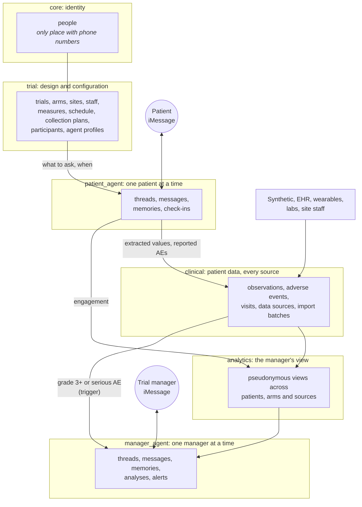
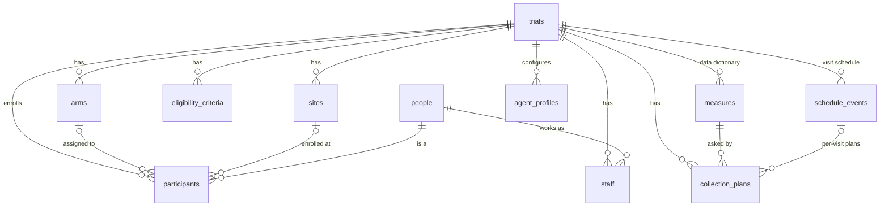
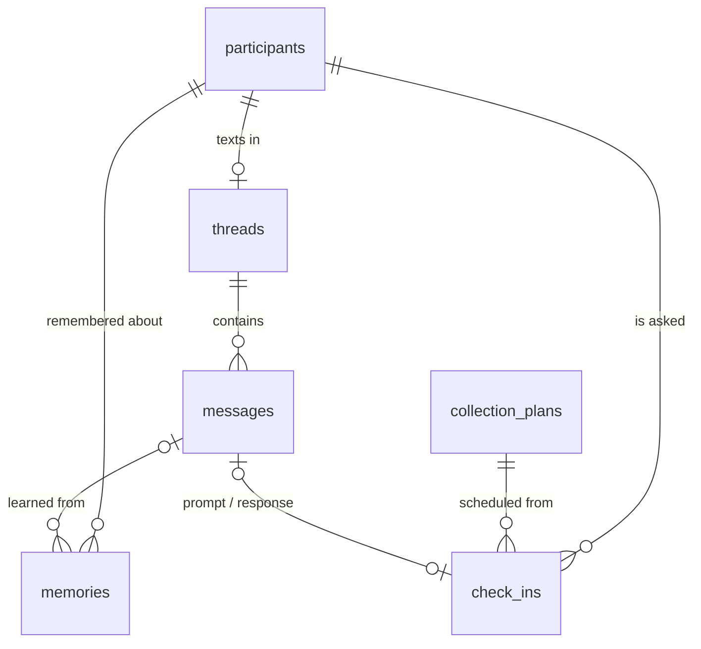
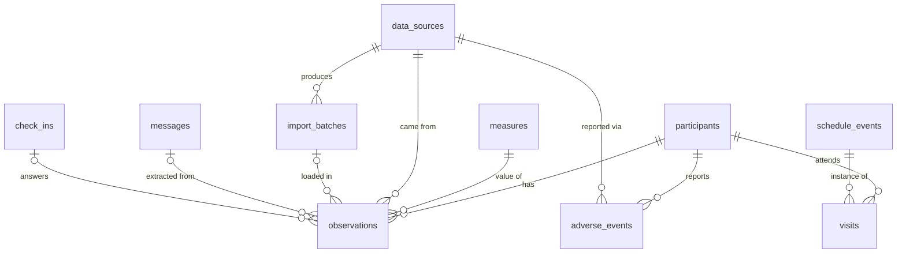
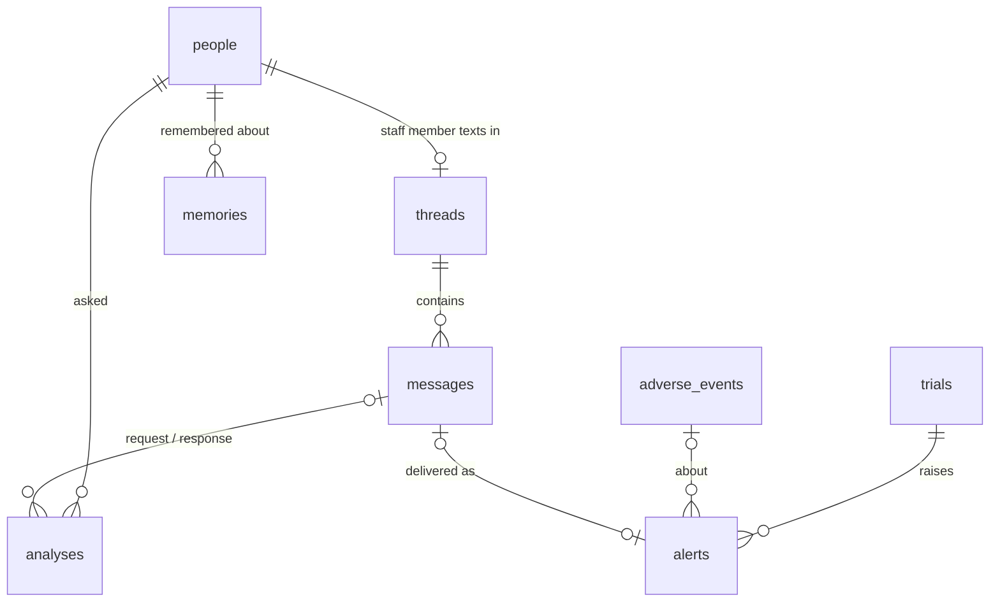

# Clinical-DB ontology

How the clinical trial database is organized, what every table means, and how data moves between the two iMessage agents. The database also documents itself: every schema, table and key column has a `COMMENT`, so `\d+ table` in psql or any SQL GUI shows the same descriptions.

## The big picture

The database has six schemas (Postgres namespaces), one per domain. Read the diagram top to bottom: a trial is configured, patients text the patient agent, their data joins data from other sources, and the trial manager reads the result through the manager agent.



| Schema | Owns | Scoped by |
| --- | --- | --- |
| `core` | People and their contact handles | — |
| `trial` | Everything decided before the first patient texts: the trial, its arms, sites, staff, eligibility, data dictionary, visit schedule, what to ask when, enrollment, agent settings | `trial_id` |
| `patient_agent` | The patient agent's working memory: conversation, long-term memories, scheduled check-ins | `participant_id` |
| `clinical` | Patient data from every source, with provenance | `participant_id` (and `trial_id`) |
| `analytics` | Read-only, pseudonymous views for managers and analysts | `trial_id` |
| `manager_agent` | The manager agent's working memory: conversation, memories, analyses, alerts | `person_id` (a staff member) |

## Core concepts

| Concept | Table | Meaning |
| --- | --- | --- |
| Person | `core.people` | A human, patient or staff. Holds name, phone (E.164), email and time zone. The only table with direct identifiers. |
| Trial | `trial.trials` | A study, for example NORTHSTAR-2. The root that almost everything belongs to. |
| Arm | `trial.arms` | A treatment group within a trial (placebo, 50 mg, 100 mg). |
| Site | `trial.sites` | A clinic that enrolls participants. |
| Staff | `trial.staff` | A person's role on a trial: manager, investigator, coordinator, monitor, data manager. |
| Participant | `trial.participants` | A person enrolled in a trial as a patient. Identified everywhere outside `core` by a pseudonymous `subject_code` (NS2-007). |
| Measure | `trial.measures` | One entry in the trial's data dictionary: what is collected, its type, unit and range (pain score 0–10, dose taken yes/no). |
| Collection plan | `trial.collection_plans` | When and how the patient agent asks about a measure (daily at 20:00, with this prompt). |
| Schedule event | `trial.schedule_events` | A protocol visit: baseline, week 2, week 4. |
| Agent profile | `trial.agent_profiles` | Persona, model and rules for a trial's patient agent or manager agent. |
| Thread | `patient_agent.threads`, `manager_agent.threads` | One conversation between an agent and one person on one channel. |
| Message | `…agent.messages` | One text in a thread, either direction. `external_id` is the messaging provider's ID (Photon). |
| Memory | `…agent.memories` | Something the agent should remember long-term: a fact, preference, concern, routine, instruction, or a conversation summary. |
| Check-in | `patient_agent.check_ins` | One scheduled question to one participant (made from a collection plan), tracked as sent, answered or missed. |
| Observation | `clinical.observations` | One value of one measure for one participant at one time, from one source. The central fact table. |
| Adverse event | `clinical.adverse_events` | A safety event (AE) with CTCAE grade, seriousness, relatedness and outcome. |
| Visit | `clinical.visits` | A participant's actual visit against a schedule event. |
| Data source | `clinical.data_sources` | Where data came from: `patient_agent`, `synthetic`, `ehr`, `wearable`, `lab`, `manual`. |
| Import batch | `clinical.import_batches` | One bulk load from a source, so it can be traced or removed as a unit. |
| Analysis | `manager_agent.analyses` | A question the manager asked, the SQL the agent ran, the result and the answer it texted. |
| Alert | `manager_agent.alerts` | Something a manager should hear about unprompted, such as a grade 3 adverse event. |

## Domains in detail

### trial: design and configuration



- **Creating a trial** is plain inserts: one `trials` row, then its arms, sites, staff, measures, schedule events and collection plans, then one `agent_profiles` row per audience (`patient`, `manager`). `db/seeds/demo.sql` is a complete worked example.
- **Measures are data, not schema.** Adding "fatigue 0–10" to a trial is a new `trial.measures` row plus a `trial.collection_plans` row. No migration needed; observations store values against the measure.
- **`value_type` decides which value column is used** in `clinical.observations`: `number`, `integer` and `scale` use `value_number`; `boolean` uses `value_boolean`; `text`, `choice` and `date` use `value_text`; anything structured can use `value_json`.
- **Composite keys keep trials apart.** Child tables reference `(trial_id, id)` pairs, so an observation can't point at a measure or participant from a different trial, even by mistake.
- `participants.status` moves `screening → enrolled → active → completed`, or ends at `withdrawn` or `screen_failed`.

### patient_agent: the per-patient iMessage agent



- **One thread per participant per channel.** `handle` is the patient's phone or iMessage email; `agent_handle` is the agent line they text; `external_space_id` is Photon's conversation ID.
- **Short-term memory** is the recent `messages` in the thread. **Long-term memory** is `memories`: the agent writes facts, preferences, concerns, routines and instructions as it learns them, plus periodic `kind = 'summary'` rows covering a span of conversation (`covers_from`, `covers_to`). Replace a memory by inserting the new one and setting the old row's `superseded_by`; current memories have `superseded_by is null`.
- **Semantic recall** is optional: `embedding` (pgvector) plus `embedding_model`. The dimension depends on the model, so compare only rows with the same `embedding_model`.
- **Check-ins** turn collection plans into concrete questions: `scheduled → sent → answered`, or `missed`, `skipped` or `cancelled`. Their answer rate is the engagement signal managers see.
- `external_id` on messages is unique, so replaying a Photon event can't store a message twice.

### clinical: patient data from every source



- **Every row says where it came from** (`source_id`). The patient agent's values also link to the exact `message_id` and `check_in_id`, plus a `confidence` for values a model extracted from free text. Synthetic and imported rows link to an `import_batch_id`.
- **`observed_at` is when the value was true**, not when it was stored. Analytics converts it to the trial's local date.
- **Never delete clinical data.** Set `status` to `amended` or `entered_in_error`; analytics ignores `entered_in_error`.
- **Adverse events** carry CTCAE `grade` (1–5) and regulatory `is_serious` separately. Inserting a grade 3+ or serious event automatically raises a `manager_agent.alerts` row (trigger `clinical.alert_on_adverse_event`).

### analytics: the trial manager's view

All views are pseudonymous (subject codes, no names or phone numbers) and cover every source.

| View | One row per | Use it for |
| --- | --- | --- |
| `analytics.trials` | trial | Status, enrollment vs target, open AEs and alerts, data volume |
| `analytics.enrollment` | trial arm | Enrollment by arm vs target |
| `analytics.participants` | participant | Roster with study day, check-in response rate, recent data, open AEs |
| `analytics.observations` | observation | Ad hoc analysis: value, measure, arm, source, local date |
| `analytics.latest_observations` | participant × measure | Current value of each measure |
| `analytics.measure_daily` | trial × arm × measure × day | Trends: daily mean, min, max, share true |
| `analytics.adverse_events` | adverse event | Safety listings |
| `analytics.adverse_event_summary` | trial × arm × term | The safety table |
| `analytics.check_in_adherence` | participant × week | How reliably each patient answers |
| `analytics.source_coverage` | trial × source | How much each source contributes (agent vs synthetic vs EHR...) |

### manager_agent: the trial manager iMessage agent



- Mirrors `patient_agent`, keyed by the staff member (`person_id`) instead of a participant.
- **`memories`** hold how this manager likes to work ("Monday 8am summary", "always use subject codes"), what they're watching ("nausea in the 100 mg arm"), and saved questions. `trial_id` null means it applies to all their trials.
- **`analyses`** is both an audit log and a cache: the question, the SQL the agent ran against `analytics.*`, the JSON result, and the iMessage-sized answer.
- **`alerts`** are what the agent texts without being asked: `open → sent → acknowledged → resolved`. `recipient_person_id` null means every staff member on the trial with `receives_alerts`.

## How the pieces work together

**A patient answers a check-in**

1. The scheduler finds due `trial.collection_plans`, creates a `patient_agent.check_ins` row, sends the prompt, stores it as an outbound `messages` row and marks the check-in `sent`.
2. The patient replies. The agent stores the inbound message, extracts the value, writes a `clinical.observations` row (source `patient_agent`, linked to the message and check-in, with a confidence) and marks the check-in `answered`.
3. If the patient mentions a symptom, the agent writes a `clinical.adverse_events` row. If it's grade 3+ or serious, the trigger raises a `manager_agent.alerts` row.
4. Along the way the agent saves anything worth remembering to `patient_agent.memories`.

**A manager asks a question**

1. The manager texts "How's adherence by arm this week?". The agent stores the message, loads this manager's `memories`, and writes SQL against `analytics.*`.
2. It records the question, SQL and result in `manager_agent.analyses`, texts a short answer, and stores the reply as a message.
3. Open `alerts` for the manager's trials are delivered the same way and marked `sent`.

## Security and scoping

| Role | Who uses it | Can do |
| --- | --- | --- |
| `developer` | Teammates | Everything, including migrations (member of `app_owner`, which owns all objects) |
| `analyst` | Notebooks, dashboards, the web browser | Read everything; every transaction is read-only |
| `patient_agent` | The patient iMessage agent service | Read trial configuration; read and write one participant's rows in `patient_agent.*` and `clinical.*`; raise alerts |
| `manager_agent` | The manager iMessage agent service | Read `analytics.*` for its staff member's trials; read and write its own `manager_agent.*` rows; update alerts |

**Row-level security keeps each agent session to one person.** Agents scope every turn in a transaction:

```sql
-- Patient agent turn
begin;
select patient_agent.use_participant(participant_id)
from patient_agent.find_participant('+16175550111') limit 1;
-- every read and write is now limited to that participant
commit;

-- Manager agent turn
begin;
select manager_agent.use_staff(person_id) from manager_agent.find_staff('+16175550100');
-- analytics.* now shows only this person's trials
commit;
```

Before `use_participant()` the patient agent sees no patient rows at all, and it can't write a row for anyone else. The manager agent sees only the trials its staff member works on, and only through the pseudonymous `analytics` views.

What this protects against: an agent (or the SQL a model writes) reaching another patient's or another trial's data. It does not stop a compromised agent service from choosing a different participant, so keep agent credentials server-side. `db/tests/access.sql` checks all of these rules.

## Conventions

- **IDs** are `uuid` from `uuidv7()`: time-ordered, safe to generate anywhere, and fine in URLs.
- **Times** are `timestamptz` (stored in UTC). Each trial has a `timezone` that analytics uses for local dates.
- **Allowed values** are `text` with `CHECK` constraints rather than enum types, so adding a value is a one-line migration. The allowed values are in the table definitions and in `db/schema.sql`.
- **`created_at` / `updated_at`** on every mutable table; a trigger keeps `updated_at` current.
- **`is_synthetic`** marks generated people, trials and participants. The demo seed uses only reserved 555-01xx phone numbers.
- **Patient-level rows carry `participant_id`** (plus `trial_id` in `clinical`), which is what both integrity and row-level security key on.

## Useful queries

```sql
-- Which measures does a trial collect, and how does the agent ask?
select m.code, m.value_type, m.unit, cp.frequency, cp.local_time, cp.prompt
from trial.measures m
left join trial.collection_plans cp on cp.measure_id = m.id
join trial.trials t on t.id = m.trial_id
where t.code = 'NORTHSTAR-2';

-- Patient agent: context for the next reply (after use_participant)
select author, body, sent_at from patient_agent.messages order by sent_at desc limit 20;
select kind, content from patient_agent.memories where superseded_by is null order by importance desc, created_at desc;

-- Patient agent: record an answer
insert into clinical.observations (trial_id, participant_id, measure_id, value_number, observed_at, source_id, message_id, confidence)
select p.trial_id, p.id, m.id, 4, now(), ds.id, :message_id, 0.95
from trial.participants p
join trial.measures m on m.trial_id = p.trial_id and m.code = 'pain_score'
join clinical.data_sources ds on ds.code = 'patient_agent'
where p.id = patient_agent.current_participant_id();

-- Manager agent: weekly mean pain by arm (the primary endpoint)
select arm_code, date_trunc('week', local_date)::date as week, round(avg(mean_value), 1) as mean_pain
from analytics.measure_daily
where trial_code = 'NORTHSTAR-2' and measure_code = 'pain_score'
group by 1, 2 order by 1, 2;

-- Manager agent: who needs a nudge?
select subject_code, arm_code, check_in_response_rate_14d, last_message_at
from analytics.participants
where status = 'active' and check_in_response_rate_14d < 0.8
order by check_in_response_rate_14d;

-- Semantic memory recall (pgvector), once embeddings are stored
select content from patient_agent.memories
where embedding_model = 'voyage-3.5' and superseded_by is null
order by embedding <=> :query_embedding limit 5;
```

## Extending the schema

- **New measure, arm, site or prompt:** insert rows; no migration.
- **New table or column:** add a migration (`dbmate new <name>`, see the README). In the same migration:
  1. Start with `set local role app_owner;` so the team owns it.
  2. Add `COMMENT ON` for the table and any non-obvious column.
  3. If it holds patient-level data, give it `participant_id`, enable row-level security and add a `patient_agent_own` policy like the ones in `20261017160600_access_control.sql`; grant `patient_agent` only what it needs.
  4. If managers should see it, add or extend an `analytics` view and filter it with `analytics.visible_trial(trial_id)`.
  5. Update this document and run `db/tests/access.sql`.
