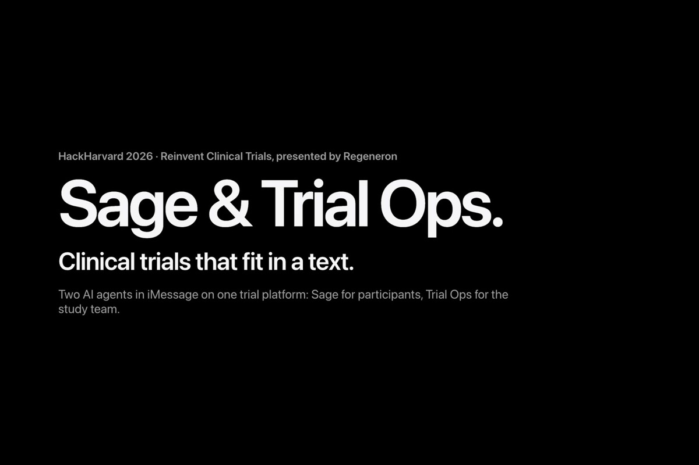
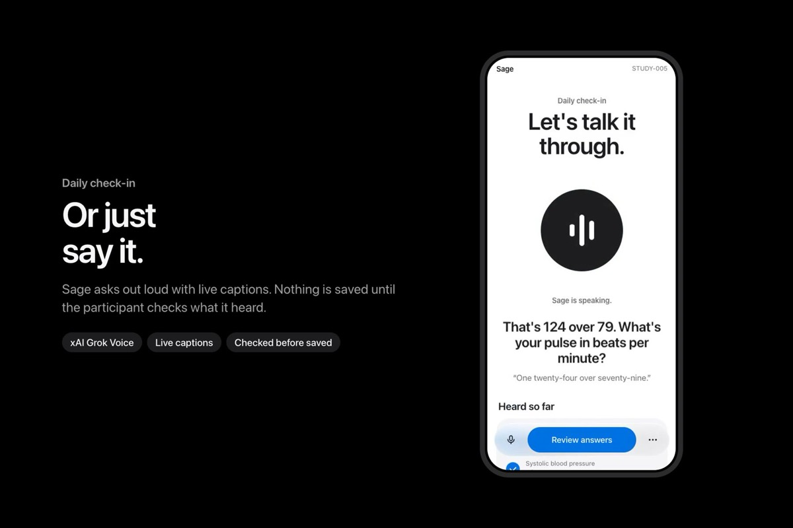
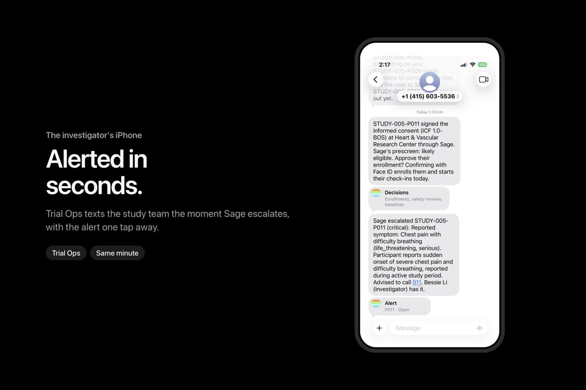
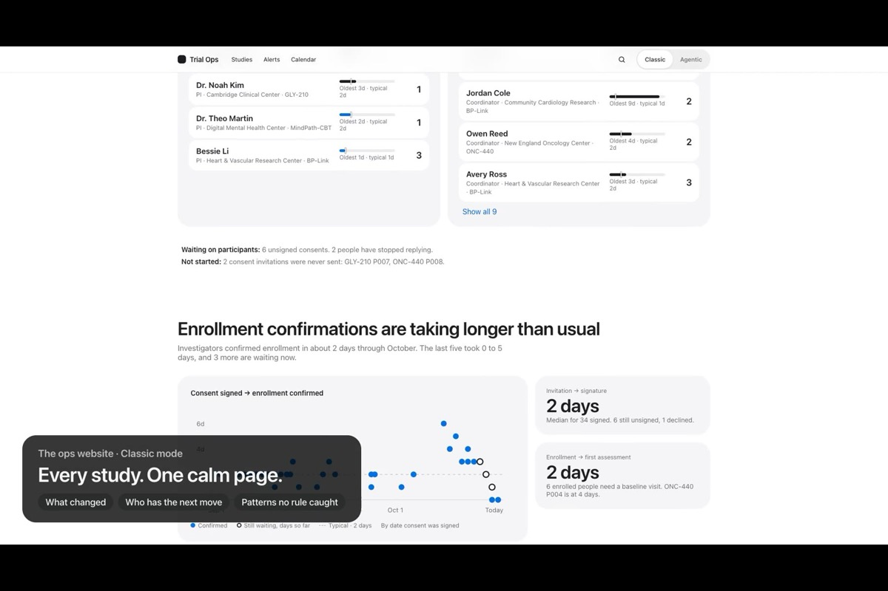
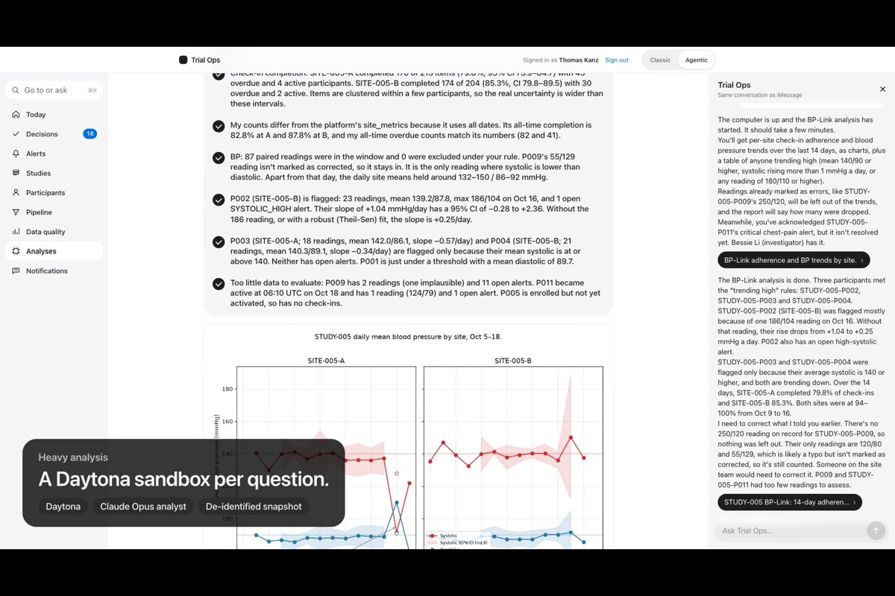
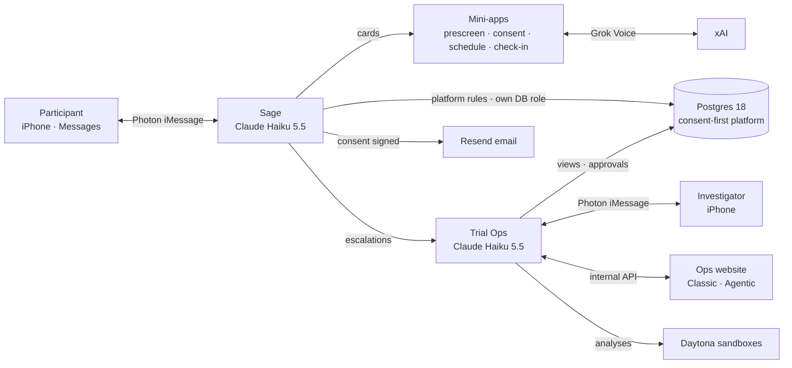

# FirstLight: clinical trials that fit in a text

**Two AI agents in iMessage, on one consent-first trial platform.** *Sage* guides participants from their first text through prescreening, informed consent, scheduling and daily check-ins, by tap or by voice. *Trial Ops* gives the study team alerts, decisions and heavy analysis in Messages and on the web. A person always makes the final call.

Built in a weekend at **HackHarvard 2026** for *Reinvent Clinical Trials & Drug Development*, presented by Regeneron.

**[▶ Watch the 3-minute demo on YouTube](https://youtu.be/BNi3T0CI5m4)** · [Patient mini-apps](https://patient.hackharvard2026.velroi.com) · [Ops website](https://ops.hackharvard2026.velroi.com) · Text Sage at **+1 415-605-6081**

---

## Why

Clinical trials rarely run out of science; they run out of people. Industry studies (Tufts CSDD) find that about one site in ten never enrolls anyone, more than a third under-enroll, and timelines stretch to nearly twice their plan. People fall out at every step: a phone screen during office hours, a 22-page consent form read alone, phone tag to book a visit, a symptom that sits unseen until the next appointment.

98% of U.S. adults carry a cellphone, and Messages is the app they open without thinking. So FirstLight meets participants there, and gives the study team an agent of their own on the other side.

## What it does

### Sage, for participants

Someone texts about a study, and every step arrives as a card in the thread that opens a mini-app inside Messages. There's no app to download and no password.

| Step | What happens |
|---|---|
| **Prescreen** | 9 or 10 questions built from the study's own eligibility rules, one per screen. Tap or say the answer. |
| **Informed consent** | Key points first, each confirmed, then a short quiz, then the signature: Face ID (a WebAuthn passkey, or the Secure Enclave in the iOS Messages extension) or a typed full name. The record keeps the form version, signer, time, method and a fingerprint of exactly what was read. The investigator is emailed at once. |
| **Scheduling** | Site, day and time in one card, booked in the thread, with a calendar invite. |
| **Daily check-ins** | Under a minute, by tap or by **voice**: with xAI's Grok Voice, Sage asks out loud with live captions, reads the reading back ("124 over 79"), and saves nothing until the participant reviews it. |
| **Safety** | Report chest pain or trouble breathing and Sage says *call 911 now*, raises a critical alert, and the study team hears within the minute. |

  
  

### Trial Ops, for the study team

The investigator's and trial manager's own agent, on its own iMessage line and on the web:

- **Answers from the live platform:** alerts, decisions, enrollment pacing, check-in adherence, data quality, workload. Each answer comes with a mini-app card.
- **Texts first:** Sage's escalations within seconds, new high-severity alerts, and a morning briefing at the time each person picks.
- **Prepares decisions, a person confirms:** enrollment, safety sign-offs, activation, alert acknowledgement and resolution. Nothing changes until someone confirms with Face ID or a typed name, and every step is audited. Confirming an enrollment activates the participant, schedules two weeks of check-ins, and has Sage welcome them.
- **Hands work to Sage:** "Ask P012 to finish signing" becomes a message from Sage in that participant's thread.
- **Heavy analysis on Daytona:** questions too big for a chat get their own Daytona sandbox (standard, large or GPU). An analyst model writes and runs Python on a de-identified snapshot, every step streams live, and a report comes back with findings, charts and tables.

### The ops website

**Classic mode** puts every study on one calm page: what changed overnight, who has the next move, where enrollment is slowing, and patterns no alert rule caught. **Agentic mode** is the same Trial Ops agent docked beside every view, with Face ID decisions, ⌘K and live analyses.

  
  

## How it fits together

- **Safety lives in the database.** Every agent tool goes through the platform's own functions, under each agent's own Postgres role. The model can ask for anything; only allowed actions happen.
- **People confirm.** Trial Ops prepares decisions, and a human confirms them as their own staff identity, with Face ID or a typed name that the record labels.
- **Data stays minimal.** Analyses see codes, not names: no message text, contacts or signatures.
- **All data is synthetic:** 5 studies, 10 sites and 40 seeded participants.

## What's in this repo

| Folder | What it is | Live |
|---|---|---|
| [`Patient-AI-Agent/`](Patient-AI-Agent/README.md) | **Sage** (participant agent, mini-apps, voice, iOS Messages extension) and **Trial Ops** (study-team agent, decisions, Daytona analyst, internal API) | [patient.hackharvard2026.velroi.com](https://patient.hackharvard2026.velroi.com) |
| [`ops-home/`](ops-home/README.md) | The ops website: Classic pages and Agentic mode | [ops.hackharvard2026.velroi.com](https://ops.hackharvard2026.velroi.com) |
| [`database/`](database/README.md) | The consent-first PostgreSQL schema, synthetic seed, access model and migration tests | |
| [`Clinical-DB/`](Clinical-DB/README.md) | The shared Postgres 18 service and its browser | |
| [`db-browser/`](db-browser/README.md) | A read-only viewer for the trial database | |
| [`server/`](server/README.md) | Server bootstrap, deploy script and Caddy proxy for every app | [hackharvard2026.velroi.com](https://hackharvard2026.velroi.com) |
| [`Photon-Demo/`](Photon-Demo/README.md) | An iMessage agent on Photon 2.0 that builds mini-apps on request | |
| [`Charles-Sprint/`](Charles-Sprint/README.md), `clinical-trial-manager-view/`, `server-load-view/` | Side projects and tools from the weekend | |

Each folder's README covers how to run it. For the database, start with [database/README.md](database/README.md): the schema, design decisions, access model, migration tests and recovery notes.

## Built with

**Claude** (Anthropic: Haiku 5.5 for Sage, Trial Ops and its analyst) · **Photon** Spectrum iMessage · **xAI** Grok Voice, speech-to-text and text-to-speech · **Daytona** sandboxes · **Resend** · PostgreSQL 18 · TypeScript and Node.js · React and Vite · WebAuthn passkeys · Swift (iOS Messages extension) · Docker and Caddy

## Team

**Thomas Kanz** and **Bessie Li**, HackHarvard 2026.
